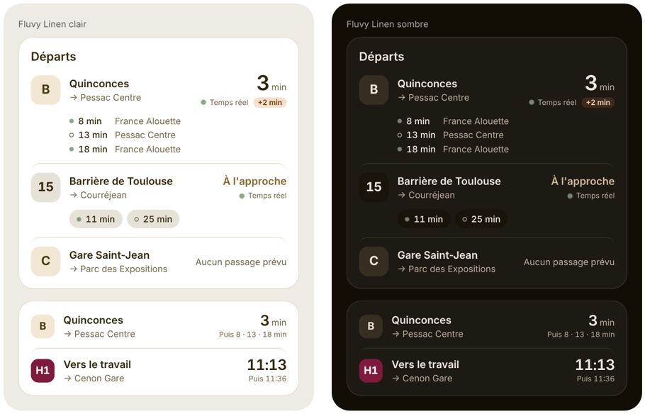

# TBM Live pour Home Assistant (non officiel)

[](https://hacs.xyz/docs/faq/custom_repositories)
[](https://github.com/itsNathanB/ha-tbm-live/actions/workflows/validate.yml)

Les prochains passages **en temps réel** des bus et trams du réseau bordelais, directement dans Home Assistant, à partir des données ouvertes publiées par Bordeaux Métropole.

Choisissez une ligne, un arrêt et un sens depuis l'interface : l'intégration crée deux capteurs, **Prochain passage** et **Passage suivant**, que vous pouvez afficher sur n'importe quel tableau de bord ou utiliser dans vos automatisations.

> [!IMPORTANT]
> **Intégration non officielle.** Ce projet communautaire n'est ni affilié, ni approuvé, ni soutenu par TBM, Keolis ou Bordeaux Métropole. Il utilise uniquement leurs données ouvertes publiques. Pour toute question sur le réseau ou les horaires, adressez-vous à TBM. Pour un problème avec l'intégration, ouvrez une [issue](https://github.com/itsNathanB/ha-tbm-live/issues) ici.

---

## Fonctionnalités

- Configuration 100 % graphique, sans YAML ni clé d'API.
- Choix guidé en trois étapes avec recherche au clavier : **ligne**, puis **arrêt**, puis **sens** (indiqué par ses terminus, branches comprises).
- **De 2 à 5 prochains passages** par arrêt, au choix, modifiable à tout moment. Chaque passage est un capteur horodaté, mis à jour toutes les 60 secondes.
- **Une carte de tableau de bord incluse**, sobre et lisible, qui s'accorde au thème [Fluvy](https://github.com/acosta290/fluvy) comme au thème par défaut, en clair comme en sombre. Rien d'autre à installer.
- Indique si l'horaire est **temps réel** ou **théorique**, et le retard en minutes.
- Ajoutez autant d'arrêts que vous voulez : une entrée par couple ligne / arrêt / sens.
- Export de diagnostics intégré pour signaler un problème.

## Prérequis

- Home Assistant **2025.2** ou plus récent.
- [HACS](https://hacs.xyz) installé.
- Un accès Internet depuis Home Assistant. L'API utilisée est publique et gratuite.

## Installation

### Avec HACS (recommandé)

1. Dans Home Assistant, ouvrez **HACS**.
2. Menu **⋮** en haut à droite → **Dépôts personnalisés**.
3. Collez l'URL `https://github.com/itsNathanB/ha-tbm-live`, choisissez le type **Intégration**, puis **Ajouter**.
4. Recherchez **TBM Live (non officiel)** dans HACS, ouvrez-la puis cliquez sur **Télécharger**.
5. **Redémarrez Home Assistant.**

### Manuellement

1. Téléchargez la dernière [release](https://github.com/itsNathanB/ha-tbm-live/releases).
2. Copiez le dossier `custom_components/tbm_live` dans le dossier `config/custom_components/` de votre Home Assistant.
3. Redémarrez Home Assistant.

## Configuration

1. **Paramètres** → **Appareils et services** → **Ajouter une intégration** → **TBM Live (non officiel)**.
2. **Ligne** : commencez à taper pour filtrer, par exemple « Tram B » ou « Bus 15 ». Les trams apparaissent en premier.
3. **Arrêt** : tapez le début du nom de l'arrêt, par exemple « Quinc » pour Quinconces. Seuls les arrêts de la ligne choisie sont proposés.
4. **Sens et nombre de passages** : choisissez la direction, indiquée par ses terminus, par exemple `Vers Pessac Centre / France Alouette`, puis le nombre de passages à suivre (2 à 5, 3 par défaut).
5. L'appareil et ses capteurs sont créés.

Pour changer ensuite le nombre de passages : **TBM Live → ⚙️ Configurer** sur l'entrée concernée. Les capteurs sont ajoutés ou retirés automatiquement.

Pour suivre un autre arrêt, un autre sens ou une autre ligne, recommencez : **Ajouter une entrée** sur la carte TBM Live.

## Entités créées

Pour chaque arrêt suivi, un appareil est créé avec un capteur de type horodatage (`timestamp`) par passage suivi :

| Capteur | Valeur |
|---|---|
| **Prochain passage** | Heure du prochain départ |
| **Passage suivant** | Heure du départ d'après |
| **3e, 4e, 5e passage** | Selon le nombre de passages choisi |

L'interface affiche nativement « dans 4 minutes ». Le capteur passe en `unknown` s'il n'y a plus de passage prévu dans les deux prochaines heures, par exemple la nuit.

### Attributs

| Attribut | Exemple | Description |
|---|---|---|
| `minutes` | `4` | Minutes avant le passage |
| `realtime` | `true` | `true` si l'horaire vient du suivi en temps réel, `false` s'il est théorique |
| `delay_minutes` | `2` | Écart avec l'horaire théorique |
| `destination` | `Pessac Centre` | Destination affichée sur le véhicule |
| `line` | `Tram B` | Ligne |
| `line_code` | `B` | Code court de la ligne |
| `stop` | `Quinconces` | Arrêt |
| `direction` | `Pessac Centre` | Sens choisi à la configuration |
| `mode` | `tram` | `tram`, `bus` ou `other` |
| `departures` | *liste* | **Prochain passage seulement** : les N prochains départs (`time`, `minutes`, `realtime`, `delay_minutes`, `destination`, `cancelled`) |

`minutes` et `departures` ne sont pas enregistrés dans l'historique pour ne pas alourdir la base de données.

## La carte



La carte est livrée avec l'intégration : après l'installation et un rafraîchissement du navigateur, elle apparaît dans **Ajouter une carte → TBM Live**, avec un éditeur visuel.

Pour chaque arrêt, elle affiche :
- le prochain passage en grand, et « À l'approche » quand il arrive ;
- un point vert pour le **temps réel** (un cercle vide pour un horaire théorique) et le retard éventuel ;
- les passages suivants, avec leur terminus quand la ligne a plusieurs branches.

Un appui sur un arrêt ouvre le détail du capteur.

```yaml
type: custom:tbm-live-card
title: Départs
entities:
  - sensor.tram_b_quinconces_france_alouette_pessac_centre_prochain_passage
  - entity: sensor.bus_15_barriere_de_toulouse_courrejean_prochain_passage
    name: Vers l'école        # remplace le nom de l'arrêt
    color: "#7E1A3B"          # couleur de la pastille de ligne
```

| Option | Par défaut | Description |
|---|---|---|
| `entities` | *obligatoire* | Un ou plusieurs capteurs **Prochain passage**. N'importe quel capteur d'un arrêt fonctionne : la carte retrouve le bon. |
| `title` | aucun | Titre de la carte |
| `count` | réglage de l'intégration | Nombre de passages affichés (1 à 5), dans la limite de ceux suivis par l'intégration |
| `show_status` | `true` | Affiche « Temps réel / Horaire théorique » et le retard |
| `compact` | `false` | Une ligne par arrêt, passages suivants en petit (« Puis 8 · 13 · 18 min ») |

Options par arrêt : `name`, `color` (fond de la pastille), `text_color`, `code` (texte de la pastille).

La carte utilise les couleurs, rayons et police du thème Fluvy s'il est actif, sinon celles de votre thème Home Assistant.

## Exemples

### Carte simple (sans la carte TBM Live)

```yaml
type: entities
title: Tram B – Quinconces
entities:
  - entity: sensor.tram_b_quinconces_pessac_centre_prochain_passage
  - entity: sensor.tram_b_quinconces_pessac_centre_passage_suivant
```

Les noms d'entités exacts dépendent de votre configuration : vérifiez-les dans **Paramètres → Entités**.

### Affichage « 4 min · 12 min »

Avec une carte Markdown :

```yaml
type: markdown
content: >
  
  🚋 **Tram B** :
  
  {{ d.minutes }} min{{ '' if d.realtime else '*' }}{{ ' · ' if not loop.last }}
  
```

L'astérisque signale un horaire théorique.

### Automatisation : prévenir avant de partir

```yaml
alias: Tram dans 5 minutes
triggers:
  - trigger: template
    value_template: >
      {{ state_attr('sensor.tram_b_quinconces_pessac_centre_prochain_passage', 'minutes') == 5 }}
conditions:
  - condition: time
    after: "07:30:00"
    before: "08:30:00"
    weekday: [mon, tue, wed, thu, fri]
actions:
  - action: notify.mobile_app_mon_telephone
    data:
      message: "Le tram B passe dans 5 minutes 🏃"
```

## Bon à savoir

- **Source des données** : flux temps réel SIRI-Lite de Bordeaux Métropole, publié en open data. Les données sont fournies telles quelles. Si le réseau ne transmet pas de position pour un véhicule, l'horaire théorique est affiché et `realtime` vaut `false`.
- **Liste des arrêts** : elle est construite à partir des courses du jour de la ligne, branches comprises. Tard le soir, si la ligne ne circule plus, une liste de secours est utilisée : elle est classée par ordre alphabétique et propose les sens génériques de la ligne. Le résultat reste correct, mais la configuration est plus agréable en journée.
- **Icône** : l'icône de l'intégration s'affiche à partir de Home Assistant **2026.3**. Les versions antérieures montrent une icône générique.
- **Terminus** : les véhicules qui terminent leur course à l'arrêt choisi ne sont pas comptés comme des départs.
- **Fréquence** : une requête par minute et par arrêt suivi. Merci de ne pas ajouter des dizaines d'arrêts inutiles, l'API est un service public gratuit.

## Dépannage

**« Impossible de joindre l'API open data temps réel de Bordeaux Métropole »**
L'API est peut-être momentanément indisponible. Réessayez quelques minutes plus tard et vérifiez que Home Assistant a bien accès à Internet.

**Aucun arrêt proposé pour une ligne**
Réessayez en journée, quand la ligne circule.

**Le capteur reste à `unknown` alors que la ligne circule**
Téléchargez les diagnostics : **Paramètres → Appareils et services → TBM Live → ⋮ → Télécharger les diagnostics**. Ouvrez ensuite une [issue](https://github.com/itsNathanB/ha-tbm-live/issues) en joignant ce fichier. Il contient la dernière réponse de l'API, sans aucune donnée personnelle.

**Activer les journaux détaillés**

```yaml
logger:
  logs:
    custom_components.tbm_live: debug
```

## Feuille de route

- [x] Carte Lovelace dédiée
- [x] Nombre de passages réglable
- [ ] Intervalle de mise à jour réglable
- [ ] Messages de perturbation du réseau

## Licence

Code sous licence [MIT](LICENSE).

Données : open data de Bordeaux Métropole, sous [Licence Ouverte / Open Licence](https://www.etalab.gouv.fr/licence-ouverte-open-licence/). Leur réutilisation n'implique aucune validation de ce projet par le producteur des données.

« TBM » et les noms associés appartiennent à leurs titulaires respectifs. Ils sont cités ici uniquement pour désigner le réseau dont les données sont affichées. L'icône de l'intégration est une création originale, sans rapport avec les logos du réseau.
